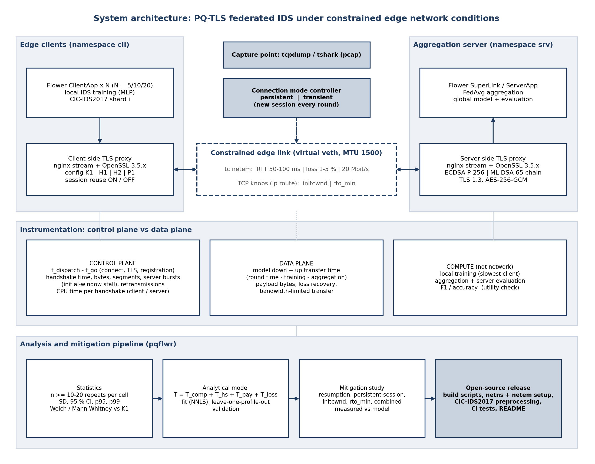

# pqflwr: Post-quantum TLS overhead in edge federated learning

Reproducible testbed that measures and models how **post-quantum TLS 1.3** (ML-KEM, ML-DSA) changes the training time of a
**federated intrusion-detection** system under **constrained and transient network conditions**.

* **Configurations:** K1 (x25519 + ECDSA P-256), H1 (X25519MLKEM768 + ECDSA), H2 (X25519MLKEM768 + ML-DSA-65), P1 (ML-KEM-768 + ML-DSA-65), PLAIN (no TLS).
* **Planes:** *control plane* (TCP + TLS handshake, registration, CPU, initial-window stalls, retransmissions) is measured separately from the
  *data plane* (model payload transfer) and from compute.
* **Network:** Linux network namespaces + `tc netem` (RTT 50-100 ms, loss 1-5 %, 20 Mbit/s) and TCP knobs (`initcwnd`, `rto_min`).
* **Variables:** persistent vs transient (per-round) connections, session resumption off/on (PSK-DHE), configuration, network profile.
* **Statistics:** >= 10-20 independent repeats per cell; SD, 95 % CI, p95, p99; Welch and Mann-Whitney vs K1.
* **Model:** `T_epoch = T_comp + T_hs + T_pay + T_loss`, fitted and validated on held-out network profiles (`analysis/model.py`).



## Requirements
Ubuntu 24.04 (or WSL2 with Ubuntu 24.04), 4 cores, 8 GB RAM, sudo. For `tc netem` the kernel must provide `sch_netem`
(`bash env/00_check_system.sh` tells you; WSL2 needs a custom kernel, see `GUIDE_PART2_WSL.md`, Appendix B).

## Quick start
```bash
git clone https://github.com/prishsha/pqflwr.git && cd pqflwr
make setup OPENSSL_VER=3.5.4          # system packages, venv, OpenSSL 3.5.x, nginx built against it
make certs                            # ECDSA P-256 and ML-DSA-65 chains
make data CSV_DIR=~/cicids2017        # CIC-IDS2017 preprocessing (or: make data SYNTHETIC=1 for a pipeline test)
make netns                            # client/server network namespaces, MTU 1500
make test && make smoke               # unit tests + FL smoke test
bash stage0.sh                        # how many TCP connections / TLS handshakes does a Flower run really make?
```

## Run the benchmark
```bash
# resumable full factorial matrix (Ctrl+C any time, run again to continue); target repeats per cell
sudo venv/bin/python controller/matrix.py --stage 7 --clients 10 --rounds 10 --repeats 10 --dry-run
sudo venv/bin/python controller/matrix.py --stage 7 --clients 10 --rounds 10 --repeats 10
python tools/check_runs.py --stage 7            # sanity checks
python analysis/stats.py --stage 7              # SD, 95 % CI, p95/p99, tests vs K1, plots
python analysis/model.py --stage 7              # fit + leave-one-profile-out validation + predictions
python analysis/crossover.py --stage 7          # measured vs predicted threshold crossings
# mitigation study (initial window / min RTO / resumption), then compare with the model
sudo venv/bin/python controller/matrix.py --stage 10 --cfgs K1 H2 P1 --modes reconnect --resumes off --profiles WAN100 LOSS3 --initcwnd 20
python analysis/mitigation.py --base-stage 7 --mit-stage 10
```
Network profiles live in `controller/profiles.py`; edit them to change the whole study.

## Repository layout
| Path | Content |
|---|---|
| `env/` | build automation: dependencies, OpenSSL 3.5.x, nginx, network namespaces, system check |
| `pki/` | certificate chains (ECDSA P-256, ML-DSA-65) and size report |
| `netem/` | `set_netem.sh` (delay, loss, rate), `tune_route.sh` (initcwnd, rto_min) |
| `proxy/` | nginx stream configuration generator |
| `fl/` | CIC-IDS2017 preprocessing, NumPy MLP, Flower client and server |
| `controller/` | one experiment cell, resumable matrix runner, network profiles |
| `stage1/` | isolated-handshake benchmark with capture, CPU time and CI |
| `analysis/` | pcap analysis, statistics, analytical model, mitigation, crossover |
| `tools/` | observation log, run sanity checks |
| `tests/`, `.github/` | unit tests, CI |
| `runs/<run_id>/` | raw evidence of every run (manifest, pcap, logs) - not committed |
| `results/` | CSV tables and plots |

## Result columns (`results/runs.csv`)
`cp_total_s` control plane (t_dispatch - t_go, summed over sessions) | `data_total_s` payload transfer | `train_total_s` slowest-client training |
`agg_total_s` aggregation + evaluation | `epoch_total_s` their sum | `n_syn`, `n_clienthello`, `n_resumed_psk` measured connections/handshakes/resumptions |
`hs_mean_ms`, `hs_s2c_bursts_mean`, `flight_span_ms_mean` handshake time and server-flight stalls | `retx_total`, `srv_tcp_retrans_delta` retransmissions |
`cpu_srv_proxy_s`, `cpu_cli_proxy_s` CPU time of the proxies | `final_f1` utility check.

## Notes and limitations
Client and server share one host (separate namespaces). Loss is applied to server-to-client segments. CPU *time* is reported because hardware
counters are not available in virtual machines. Flower is pinned to 1.13.1 and uses its classic `start_server`/`start_client` API.
In OpenSSL 3.5, ML-KEM and ML-DSA are native, so oqs-provider is not in the data path.

## License
MIT. See `LICENSE`.
